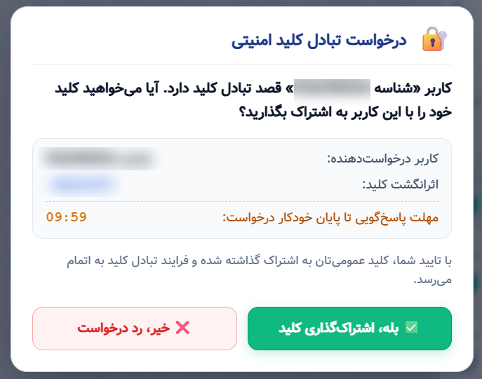
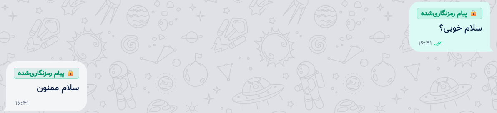

<div align="center">


# پردگ (Pardag)

**افزونه رمزنگاری سرتاسری در لایه کاربرد برای پیام‌رسان‌های تحت وب (پشتیبانی فعلی: بله)**

</div>

**پردگ (Pardag)** یک افزونه متن‌باز (Manifest V3) است که پیام‌های متنی را پیش از تحویل به رابط وب پیام‌رسان، در مرورگر شما رمزنگاری و در مرورگر مخاطب رمزگشایی می‌کند. این افزونه هیچ اتصال جداگانه‌ای باز نمی‌کند، به توکن‌ها یا کوکی‌های حساب دسترسی ندارد و تمام کلیدها را صرفاً در حافظه محلی مرورگر (`chrome.storage.local`) نگهداری می‌کند.

## پیش‌نمایش

### ۱. دریافت درخواست تبادل کلید امنیتی

هنگامی که مخاطب درخواست رمزنگاری خودکار (RSA) را ارسال می‌کند، پنجره تأیید با اثرانگشت کلید و مهلت پاسخ‌گویی ۱۰ دقیقه‌ای نمایش داده می‌شود:



### ۲. پیام‌های رمزنگاری‌شده داخل گفتگو

پیام‌ها پیش از ارسال رمزنگاری شده و در گفتگو به‌صورت خودکار با نشان امنیتی رمزگشایی و نمایش داده می‌شوند:



## امکانات کلیدی

| قابلیت | توضیح | 
| ----- | ----- | 
| **تبادل خودکار کلید (RSA)** | برقراری ارتباط امن در چت‌های خصوصی ۱:۱ بدون نیاز به رد و بدل کردن رمز از کانال دیگر، با پنجره تأیید و مهلت خودکار **۱۰ دقیقه**. | 
| **حالت پسورد مشترک** | رمزنگاری با عبارت عبور توافقی (الزاماً در **گروه‌ها** و به‌صورت اختیاری در چت‌های خصوصی) با مشتق‌سازی کلید PBKDF2-SHA-256. | 
| **تشخیص خودکار نوع گفتگو** | تفکیک دقیق چت‌های **شخصی**، **گروه**، **کانال** و **ربات** از لایه پروتکل WebSocket و DOM؛ جلوگیری از فعال‌سازی رمزنگاری در کانال‌ها و ربات‌ها و قفل کردن حالت گروه روی پسورد مشترک. | 
| **تأیید هویت با کد امنیتی** | تولید کد امنیتی ۳۲ کاراکتری برای مقایسه حضوری یا صوتی و هشدار فوری در صورت تغییر کلید مخاطب. | 
| **ویرایش امن پیام‌ها** | بازگردانی متن اصلی هنگام ویرایش پیام‌های رمزنگاری‌شده (چه با کلیک موس و چه با کلید جهت بالا) و لغو خودکار حالت ویرایش برای پیام‌های تبادل کلید. | 
| **محافظ پیش‌نویس محلی** | جلوگیری از ارسال متن خام پیش‌نویس به سرور پیام‌رسان از طریق پاک‌سازی فریم‌های پیش‌نویس در WebSocket و نگهداری موقت پیش‌نویس در حافظه محلی مرورگر. | 
| **پشتیبان‌گیری رمزنگاری‌شده** | خروجی گرفتن (`Export`) و بازیابی (`Import`) هویت رمزنگاری و سابقه چت‌ها در قالب فایل رمزنگاری‌شده `.pardag`. | 
| **حفظ سابقه کلیدها** | نگهداری تاریخچه کلیدهای قبلی و پسوردهای پیشین برای خواندن پیام‌های قدیمی، همراه با بازنشانی خودکار چت‌های RSA هنگام تعویض کلید هویت. | 

## امنیت و معماری رمزنگاری

پردگ از استانداردهای بومی **Web Crypto API** مرورگر استفاده می‌کند:

* **رمزنگاری پیام‌ها (Hybrid — `PARDAG2:`)**: هر پیام با یک کلید تصادفی **AES-256-GCM** رمز شده و کلید آن با **RSA-OAEP (2048-bit, SHA-256)** هم برای مخاطب و هم برای خود فرستنده بسته‌بندی می‌شود تا پیام‌های ارسالی پس از رفرش صفحه نیز قابل خواندن باشند.

* **امضای دیجیتال**: تمام پیام‌های هیبریدی و بسته‌های تبادل کلید (`PARDAG-KEY:`) با **ECDSA P-256** امضا می‌شوند تا اصالت فرستنده و عدم دستکاری پیام بررسی شود.

* **حالت پسورد مشترک (`PARDAG1:`)**: کلید AES-256-GCM با **PBKDF2-SHA-256** (۶۰۰٬۰۰۰ دور) مشتق می‌شود.

## نصب و راه‌اندازی

پروژه بدون نیاز به مرحله Build (با ES Modules خالص) اجرا می‌شود:

1. مخزن یا فایل فشرده پروژه را دانلود و از حالت فشرده خارج کنید.

2. در مرورگر Chrome یا Edge وارد صفحه `chrome://extensions` شوید.

3. گزینه **Developer mode** را فعال کنید.

4. روی **Load unpacked** کلیک کرده و پوشه پروژه را انتخاب کنید.

5. صفحه [`web.bale.ai`](https://web.bale.ai) را باز کرده و با `Ctrl+Shift+R` رفرش کنید.

## راهنمای سریع استفاده

1. **چت خصوصی ۱:۱ (RSA)**: وارد گفتگو شوید و روی دکمه وضعیت یا آیکون افزونه کلیک کنید، روش **«تبادل کلید RSA»** را بزنید تا درخواست ارسال شود. پس از تأیید مخاطب، ارتباط رمزنگاری‌شده فعال می‌شود.

2. **گروه (پسورد مشترک)**: در چت‌های گروهی فقط روش **«پسورد مشترک»** فعال است؛ یک رمز حداقل ۸ کاراکتری وارد کرده و همان رمز را در اختیار اعضای مجاز قرار دهید.

3. **پشتیبان‌گیری**: از تب **«امنیت و پشتیبان‌گیری»** در پاپ‌آپ افزونه، یک فایل `.pardag` تهیه کنید تا با حذف یا انتقال مرورگر، کلید هویت و دسترسی به پیام‌های قدیمی از دست نرود.

## ساختار پروژه

```
├── manifest.json
├── docs/
│   └── screenshots/
│       ├── key-exchange-request.png
│       └── encrypted-chat.png
└── src/
    ├── background/
    │   └── service-worker.js
    ├── content/
    │   ├── adapters/
    │   ├── crypto/
    │   ├── ui/
    │   ├── content.js
    │   ├── loader.js
    │   └── websocket-draft-guard.js
    ├── icons/
    ├── popup/
    └── shared/

```